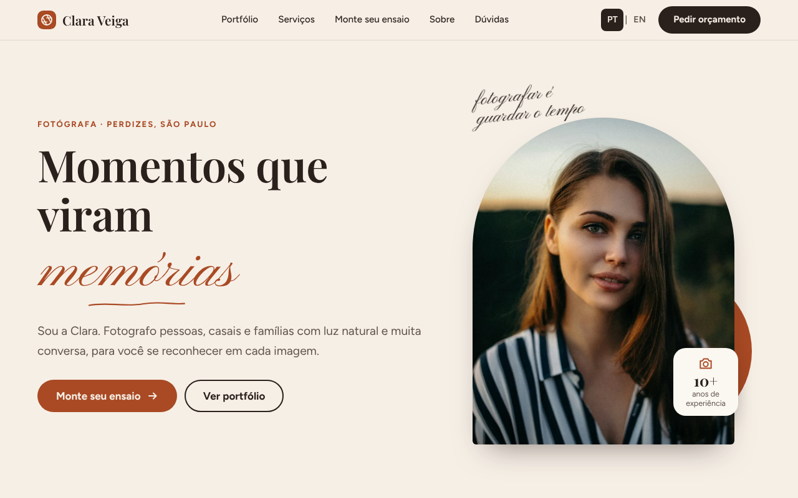

# Clara Veiga Fotografia: site modelo para fotógrafa

Modelo de site demonstrativo para **fotógrafa** (retratos, casais, famílias e eventos). Nome, preços e depoimentos são **fictícios**. As fotos são do Unsplash (veja abaixo).




## O que tem

- **Monte seu ensaio**: o visitante escolhe tipo de ensaio, pacote (Essencial, Completo ou Premium), extras e melhor luz. O valor estimado aparece na hora e o pedido vai pronto para o WhatsApp.
- **Portfólio com filtro** por categoria (retratos, casais, famílias, eventos, paisagens e detalhes; botões com `aria-pressed`) e fotos em WebP com carregamento sob demanda.
- Bilíngue: português em `/` e inglês em `/en/`, com seletor PT | EN.
- Todo o conteúdo e todos os preços em um só arquivo: `src/data.js`.
- Pré-renderização estática (HTML pronto no build), Open Graph, JSON-LD e `hreflang`/`canonical` (quando `site.url` estiver preenchido).
- Responsivo (testado em 360, 390 e 1280 px) e acessível: foco visível, link "pular para o conteúdo", FAQ com `<details>` e `prefers-reduced-motion` respeitado.

## Tecnologia

Vite 5 + React 18. Fontes Playfair Display, Figtree e Pinyon Script, hospedadas no próprio projeto (sem CDN).

## Como rodar

```bash
npm install
npm run dev       # desenvolvimento
npm run build     # build + pré-renderização em dist/
npm run preview   # servir o build
```

## Como adaptar para uma fotógrafa real

1. Troque textos, preços (`baseByType`, `packages`, `extrasPrice`) e pacotes em `src/data.js`.
2. Troque `site.whatsapp` (formato internacional, só dígitos) e `site.instagram`.
3. Preencha `site.url` com o endereço final e faça o redeploy (liga canonical, hreflang, og:url, og:image absoluto, sitemap e robots.txt).
4. **Apague a linha `<meta name="robots" content="noindex, nofollow">`** em `index.html`. Ela existe só porque os dados do modelo são fictícios.
5. Troque `public/og.png`, `public/og-en.png` (1200 x 630) e `public/favicon.svg`.

## Fotos

As fotos de demonstração vêm do [Unsplash](https://unsplash.com/license) (uso comercial permitido, sem obrigação de crédito), otimizadas em WebP (até 1400 px) em `public/fotos/`. O site mostra "Fotos: Unsplash" no rodapé.

| Arquivo | Foto no Unsplash |
| --- | --- |
| `retrato-1.webp` | https://unsplash.com/photos/QXevDflbl8A |
| `retrato-2.webp` | https://unsplash.com/photos/hOP2CQ9dGWg |
| `casal-1.webp` | https://unsplash.com/photos/VX2nrLhq4h4 |
| `casal-2.webp` | https://unsplash.com/photos/0dXvugMScIY |
| `familia.webp` | https://unsplash.com/photos/4_mJ1TbMK8A |
| `evento.webp` | https://unsplash.com/photos/cuKJre3nyYc |
| `paisagem-1.webp` | https://unsplash.com/photos/TK9UzLyqtVg |
| `paisagem-2.webp` | https://unsplash.com/photos/m_uSWBJWr0s |
| `detalhe.webp` | https://unsplash.com/photos/MyQ8Re-OqzI |

**Atenção:** o Unsplash não garante autorização de uso de imagem das pessoas nem de marcas que aparecem nas fotos. Para um cliente real, use as fotos do próprio cliente.

### Como trocar por fotos de uma cliente

1. Otimize as fotos (WebP ou JPG, até uns 1400 px no lado maior) e coloque em `public/fotos/`.
2. Em `src/data.js`, edite `photos`: caminho (`src`), largura e altura (`w`, `h`) e o ponto de foco do corte (`pos`, no formato `"50% 30%"`).
3. Em `content.pt.portfolio.items` e `content.en.portfolio.items`, troque o título e o texto alternativo (`alt`) de cada foto por uma descrição real.
4. Para mudar categorias ou a ordem da galeria, edite `gallery` em `src/data.js`.
5. Apague a menção "Fotos: Unsplash" em `demoNotice` (`src/data.js`) se não usar mais fotos do Unsplash.

## Publicação

Deploy na Vercel (projeto próprio): framework Vite, comando `npm run build`, pasta de saída `dist`.
Para clientes reais, use Cloudflare Pages ou Netlify (o plano gratuito da Vercel é só para uso não comercial).

## Estrutura

```
src/data.js            conteúdo PT/EN, preços e contato
src/App.jsx            componentes, filtro do portfólio e montador de ensaio
src/styles.css         estilos (cores no :root)
src/entry-client.jsx   entrada do navegador (hidratação)
src/entry-server.jsx   entrada da pré-renderização
scripts/prerender.mjs  gera dist/index.html e dist/en/index.html
public/                favicon, og.png, og-en.png e fotos/
docs/                  prints usados neste README
```
